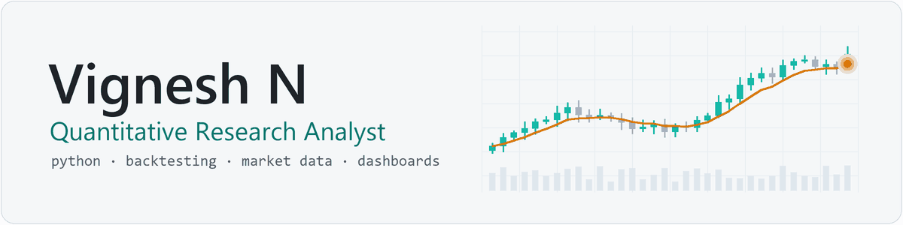

<picture>
  <source media="(prefers-color-scheme: dark) and (prefers-reduced-motion: reduce)" srcset="assets/banner-dark.png">
  <source media="(prefers-reduced-motion: reduce)" srcset="assets/banner-light.png">
  <source media="(prefers-color-scheme: dark)" srcset="assets/banner-dark.gif">
  
</picture>

### Python for market research, backtesting and trading analytics

I build the tools quantitative research runs on: backtesting frameworks, real-time market-data dashboards, and the data infrastructure underneath them, with a focus on data quality, testing and reliable systems.

**[LinkedIn](https://www.linkedin.com/in/vignesh-n-business)** · **[Email](mailto:iamvignesh.work@gmail.com)** · Tamil Nadu, India

---

## What I work on

- **Systematic research and backtesting.** Backtesting and simulated (paper) trade testing of strategies across US equities, options, futures and futures options.
- **Real-time market data and dashboards.** Python trading dashboards (Dash, PyQt6) on live US market data, with Redis for fast shared state.
- **Data and cloud infrastructure.** Cloud databases and Linux environments on Azure, with experience on AWS and GCP.
- **Machine learning, as a supporting tool.** Classification, clustering and time-series models with scikit-learn, PyTorch and TensorFlow.

## Experience

**Quantitative Research Analyst** · Maxrey Tech Limited · Mar 2026 – present · Remote Trading dashboards and analytical tools (Python, PyQt6, Dash, Redis, Azure); backtesting and simulated trade testing of US-market strategies; Azure cloud databases and Linux.

**Quantitative Research Analyst** · Fiedge Capital · Apr 2025 – Feb 2026 · Remote Python trading dashboards on real-time US market data (Charles Schwab API); backtesting frameworks across equities, options, futures and futures options; analytics and performance-reporting tools.

**Python Developer (training)** · Elysium Group · Mar 2024 – Apr 2025 Flask and Streamlit applications combining ML, encryption, blockchain storage and PySpark processing.

**Business Analyst Intern** · Beleaf Technologies · Jun – Nov 2023 Planning for blockchain and crypto-trading projects; Power BI and Google Analytics.

## Toolkit

- **Core:** Python · Pandas · NumPy · SQL · Redis · Linux · Git
- **Dashboards and apps:** Dash · PyQt6 · Streamlit · Flask · FastAPI
- **Machine learning:** scikit-learn · PyTorch · TensorFlow · Keras · PySpark
- **Data and cloud:** PostgreSQL · MySQL · MongoDB · SQLite · Azure · AWS (EC2, S3) · GCP

## Public projects

Earlier work from my studies and internship:

- **[Share-Market-Website](https://github.com/Vignesh-Eren/Share-Market-Website)** — a PHP/MySQL stock-market learning site: a page for each NIFTY 50 company, charts, a portfolio tracker (stocks, mutual funds, currencies, commodities) and lessons on fundamental and technical analysis.
- **[Data-Analytics-Internship](https://github.com/Vignesh-Eren/Data-Analytics-Internship)** — data cleaning and summary statistics in Python notebooks, and a Tata Motors price dashboard in Power BI.

## Education and certifications

- MCA, University of Madras (2021–2023)
- BSc Information Technology, The American College, Madurai (2018–2021)
- [Machine Learning Specialization](https://www.coursera.org/account/accomplishments/specialization/ZXQMJSDZUYR4) — Stanford University / Coursera
- [Business Analytics Specialization](https://www.coursera.org/account/accomplishments/specialization/KEXF2XGSYME6) — University of Pennsylvania / Coursera
