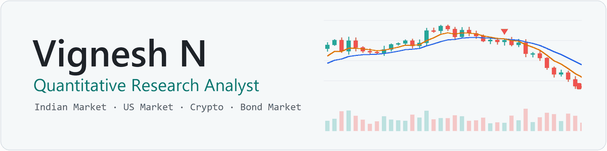
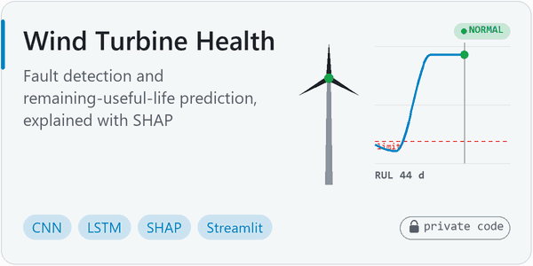
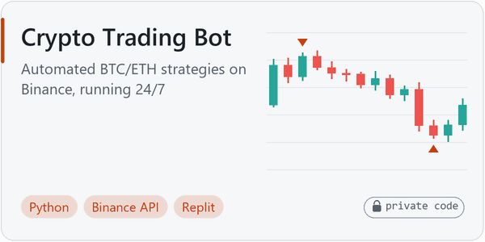
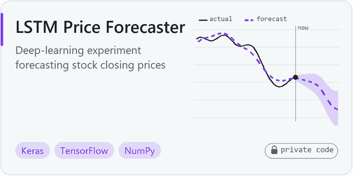
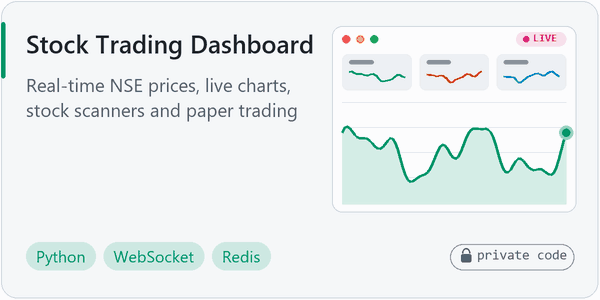

<picture>
  <source media="(prefers-color-scheme: dark) and (prefers-reduced-motion: reduce)" srcset="assets/header-dark-a55a277.png">
  <source media="(prefers-reduced-motion: reduce)" srcset="assets/header-light-63bee2a.png">
  <source media="(prefers-color-scheme: dark)" srcset="assets/header-dark-789d5f8.gif">
  
</picture>

  
  
  

I build backtests, trading dashboards and market-data tools in Python.

## Projects

  <picture><source media="(prefers-color-scheme: dark)" srcset="assets/card-turbine-dark-f5b2927.gif"></picture>
  <picture><source media="(prefers-color-scheme: dark)" srcset="assets/card-crypto-dark-d0c65d2.gif"></picture>

  <picture><source media="(prefers-color-scheme: dark)" srcset="assets/card-lstm-dark-3232438.gif"></picture>
  <picture><source media="(prefers-color-scheme: dark)" srcset="assets/card-dashboard-dark-daf70b6.gif"></picture>

🔒 Code kept private. Happy to walk through any of them.

## Tech

  
  
  
  
  
  
  
  
  
  
  
  
  
  

## Experience

Trading dashboards, backtesting and real-time market data for US equities, options and futures.

- **Quant Research Analyst** · Maxrey Tech · 2026 – now
- **Quant Research Analyst** · Fiedge Capital · 2025 – 2026
- **Python Developer** (training) · Elysium Group · 2024 – 2025
- **Business Analyst Intern** · Beleaf Technologies · 2023

## Education

- 🎓 MCA, University of Madras · BSc IT, The American College
- 📜 [Machine Learning](https://www.coursera.org/account/accomplishments/specialization/ZXQMJSDZUYR4) (Stanford) · [Business Analytics](https://www.coursera.org/account/accomplishments/specialization/KEXF2XGSYME6) (UPenn), Coursera specializations
